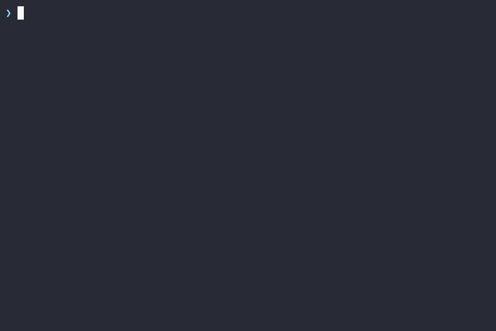

# create-corestack-app

[](https://www.npmjs.com/package/create-corestack-app)
[](https://opensource.org/licenses/MIT)
[](https://nodejs.org)

### Scaffold production-ready Node.js backends in seconds.

CoreStack is a CLI generator for modern TypeScript backends. Effortlessly generate clean REST APIs with your choice of database - PostgreSQL or MongoDB, complete with enterprise-grade JWT authentication, interactive Scalar API documentation, and Docker Compose out of the box.

<p align="center">
  
</p>

---

## 🚀 Quick Start

Run any of the following commands in your terminal to start the interactive scaffolder:

```bash
# Using pnpm
pnpm create corestack-app my-app

# Using npm
npm create corestack-app@latest my-app

# Using Bun
bun create corestack-app my-app

# Using Yarn
yarn create corestack-app my-app
```

> **Note**: You can omit `my-app` to be prompted for a project name interactively.

---

## What's Included

- **Database Support**: PostgreSQL (Prisma) and MongoDB (Mongoose).
- **Authentication & Authorization**: JWT, refresh tokens, RBAC, and permissions.
- **Modular Architecture**: Clean, maintainable TypeScript structure with dependency injection and inversion of control.
- **API Documentation**: Interactive Scalar API reference.
- **Docker Support**: Ready-to-use Dockerfile and Compose configuration.
- **Testing & CI Ready**: Pre-configured Vitest test suite and tailored GitHub Actions CI workflow.

---

## CLI Options & Flags

When running `create-corestack-app`, you can configure your project interactively or pass flags to automate the setup:

| Flag                  | Description                                                     | Default           |
| :-------------------- | :-------------------------------------------------------------- | :---------------- |
| `[target-dir]`        | Directory where the project will be created                     | `my-app`          |
| `-r, --recommended`   | Use recommended presets (PostgreSQL, Auth, Scalar Docs, Docker) | Interactive       |
| `-d, --database <db>` | Database provider (`postgres` or `mongodb`)                     | `postgres`        |
| `--no-auth`           | Exclude authentication, JWT tokens, and RBAC                    | `auth included`   |
| `--no-docs`           | Exclude Scalar OpenAPI documentation                            | `docs included`   |
| `--no-docker`         | Exclude Dockerfile and Compose files                            | `docker included` |
| `--skip-install`      | Scaffold files only, skip dependency installation and git init  | `false`           |

### Quick Examples

```bash
# Recommended full-stack preset
pnpm create corestack-app my-api --recommended

# MongoDB backend
pnpm create corestack-app analytics-service -d mongodb

# Minimal public API without authentication or Docker
npm create corestack-app@latest public-api -- --no-auth --no-docker

# Fast scaffolding without installing packages (great for CI or inspection)
bun create corestack-app test-app --skip-install
```

---

## Getting Started

Once scaffolding completes, follow these simple steps to run your backend:

### 1. Navigate to your project

```bash
cd my-app
```

### 2. Start your database (Docker)

If you chose **PostgreSQL**:

```bash
docker compose up -d postgres
pnpm migration:dev
```

If you chose **MongoDB**:

```bash
docker compose up -d mongodb mongo-express
```

_(Mongo Express web GUI will be available at `http://localhost:8081`)_

### 3. Start the development server

```bash
pnpm dev
# or: npm run dev / bun dev / yarn dev
```

Your API will be running at `http://localhost:3000` with interactive API documentation at `http://localhost:3000/docs`.

---

## Author

- **Estifanos**
    - GitHub: [@estifz](https://github.com/estifz)
    - Email: [kingestiff@gmail.com](mailto:kingestiff@gmail.com)

## License

Distributed under the MIT License. See [LICENSE](https://github.com/estifz/Corestack/blob/main/LICENSE) for more information.

## Links

- **GitHub Repository**: [https://github.com/estifz/Corestack](https://github.com/estifz/Corestack)
- **Issue Tracker**: [https://github.com/estifz/Corestack/issues](https://github.com/estifz/Corestack/issues)
